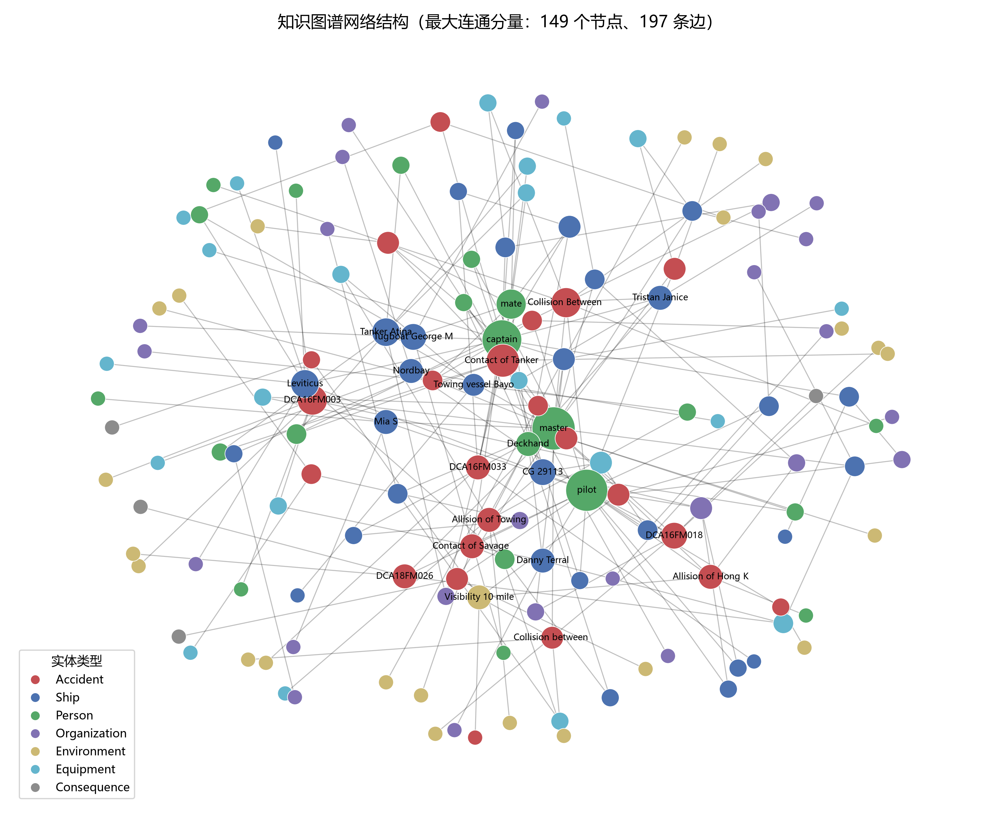
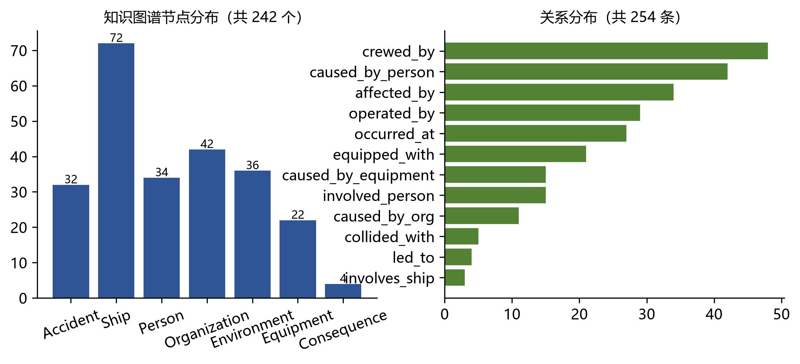
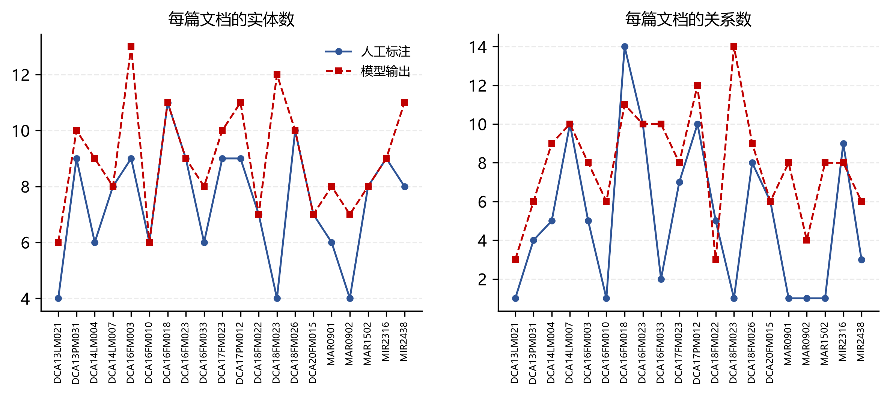
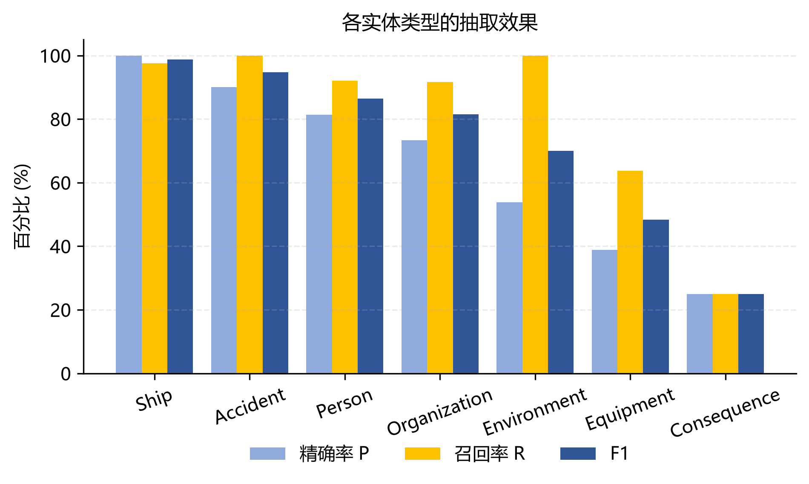
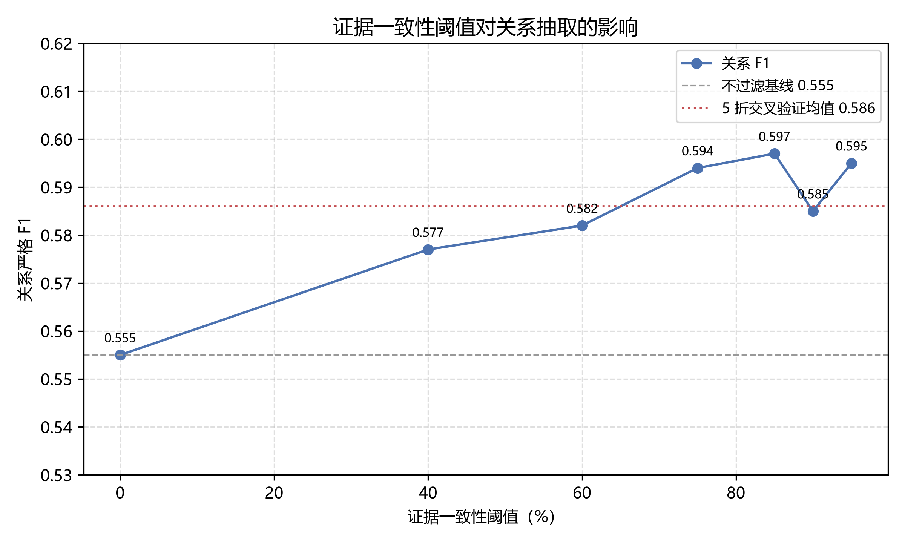
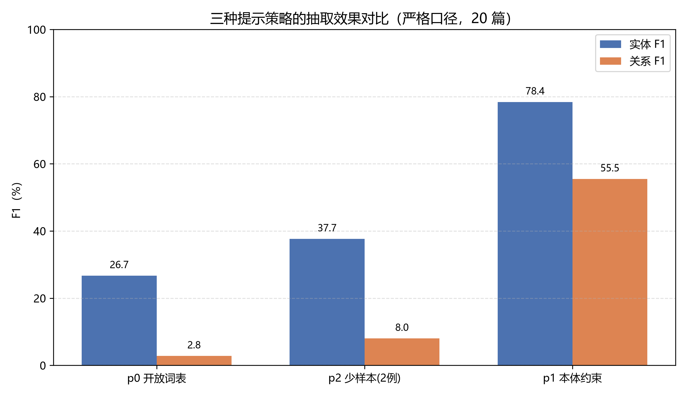
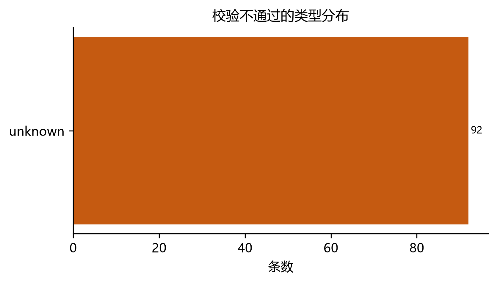

# 基于大语言模型的船舶碰撞事故知识图谱构建

> 本科毕业设计（论文）初稿 · 自动生成于 2026-11-02
> 说明：文中所有数字均由 `ship-collision-kg` 仓库内脚本实测产出，复现命令见第 6.9 节。
> 「XXXX」处需按学校模板补学号、姓名、指导教师、专业等信息。

---

## 摘要

船舶碰撞事故调查报告是海事安全分析的第一手资料，其中蕴含事故经过、致因因素、涉事船舶与人员、环境条件等多维信息。传统上这些信息依赖人工阅读与摘录，效率低、一致性差，难以支撑大样本统计。本文以美国国家运输安全委员会（NTSB）公开的海事事故调查报告为数据源，研究在本地化部署的中等规模大语言模型（`qwen2.5:7b-instruct`）条件下，如何通过本体约束、结构化输出校验与后处理修复，把非结构化报告批量转换为可查询的船舶碰撞事故知识图谱。

主要工作如下：（1）构建了覆盖中美英三国 285 起事故的种子表，并整理出 167 篇 NTSB 全文语料，按事故聚合分层划分为训练/验证/测试三部分；（2）设计了 7 类实体、12 类关系的海事事故本体，并给出零样本、本体约束、本体加少样本三种提示策略；（3）实现了「分节预算截断—结构化抽取—JSON 解析—本体一致性校验—证据一致性过滤—节点合并」的完整管线，其中后处理环节能够修复模型输出中 15% 左右的关系挂载错误；（4）在 20 篇人工标注文档上取得实体严格匹配 F1 0.784、关系严格匹配 F1 0.555，关系级经证据一致性过滤后提升至 0.597，并用 5 折交叉验证证明该阈值并非在评测集上调出；（5）在 33 篇验证集文档上构建了含 242 个节点、254 条边的知识图谱，在 67 篇文档上扩展到 480 个节点、515 条边。

实验同时暴露了两点值得记录的现象：其一，在缺少完整原文、输入被截断到 1.2 万字符的前提下，关系抽取的瓶颈是精确率（0.52）而非召回率（0.80），主要来自模型对环境与设备类实体的过度抽取；其二，常识上「加示例会更好」并不成立——少样本示例会把模型校准到示例的类型配比上，当示例缺少某类实体时，该类实体的抽取准确率直接归零，本文通过补充一条以设备类为主的示例验证了这一点。

**关键词**：知识图谱；大语言模型；信息抽取；船舶碰撞；海事事故调查

---

## Abstract

Maritime casualty investigation reports are the primary source for marine safety analysis, yet extracting structured knowledge from them still relies heavily on manual reading. This thesis studies how to convert NTSB marine casualty reports into a queryable knowledge graph using a locally deployed 7B-parameter large language model. A complete pipeline is implemented, covering section-aware truncation, ontology-constrained extraction, schema validation, evidence-consistency filtering and node merging. On 20 manually annotated documents, strict entity F1 reaches 0.784 and strict relation F1 reaches 0.555, the latter improving to 0.597 with evidence filtering, whose threshold is validated by 5-fold cross validation. A knowledge graph with 242 nodes and 254 edges is built on the 33-document validation split, and extended to 480 nodes and 515 edges on 67 documents. Two findings are reported: relation precision, rather than recall, is the bottleneck under truncated input; and few-shot examples can degrade performance when their entity-type distribution is not representative.

**Keywords**: Knowledge Graph; Large Language Model; Information Extraction; Ship Collision; Maritime Casualty Investigation

---

## 第 1 章 绪论

### 1.1 研究背景与意义

水上交通事故的统计分析与规律挖掘，长期受制于数据的非结构化程度。以 NTSB 发布的海事事故调查报告为例，单份报告通常包含事故概况、事实描述、分析与结论、可能原因、安全建议等章节，篇幅从数千到数万字符不等。研究者若想回答「哪些人为因素在碰撞事故中出现频率最高」「某类船型在何种环境下更易发生事故」这类问题，需要逐份阅读并摘录，人工成本极高，且不同标注者之间的粒度与用词差异会显著影响结论的可靠性。

知识图谱以「实体—关系—实体」三元组刻画领域知识，天然适合表达「某船在某水域因某设备故障与某船发生碰撞，造成某后果」这类结构化事实。若能把调查报告批量转换为知识图谱，原本需要人工翻阅的问题就可以转化为图查询，进而支撑事故规律统计、相似事故检索与安全建议的归纳。

近年来，大语言模型（Large Language Model, LLM）在信息抽取任务上展现出很强的零样本与少样本能力，使得「不训练专用模型、直接以提示词驱动抽取」成为可行路线。对本科毕业设计而言，这条路线的好处是无需标注大规模训练集、无需 GPU 训练，一台带 6 GB 显存的笔记本即可完成全流程；坏处是模型输出不稳定、类型体系不自洽、证据难以追溯，必须靠工程手段加以约束。

本文要解决的问题因此可以概括为：**在有限算力与有限标注条件下，如何让一个 7B 级别的本地大模型，稳定地把海事事故调查报告转换成符合领域本体的知识图谱，并对转换质量给出可信的量化评价。**

### 1.2 国内外研究现状

**（1）知识图谱构建。** 知识图谱的概念自 2012 年由 Google 提出后迅速发展，Hogan 等在 *Knowledge Graphs* 一文中系统梳理了知识图谱的数据模型、查询语言与推理机制[J]. Ji 等则在综述中将知识图谱构建归纳为知识抽取、知识融合与知识推理三个环节，其中知识抽取是自底向上构建的核心[D]. 面向垂直领域，构建路线通常有两种：一是基于规则与词典的模板抽取，精度高但覆盖面窄；二是基于机器学习的序列标注与关系分类，需要较大规模标注语料。

**（2）大模型驱动的信息抽取。** 自 GPT-3 展示少样本能力以来，以提示词驱动的方式完成命名实体识别与关系抽取成为研究热点。这类方法的优势在于把「建模」问题转化为「提示设计 + 输出约束」问题；劣势在于输出格式不稳定、存在幻觉、对长文本的覆盖能力受上下文窗口限制。工程上常见的补救手段包括：给出 JSON Schema 并做后置校验、要求模型对每条结果给出原文证据、在提示中显式列出类型体系与禁止项。

**（3）海事事故文本挖掘。** 国内外针对海事事故报告的研究多集中于事故致因分类、文本聚类与主题模型，面向知识图谱的系统性构建相对较少；已有的图谱工作多聚焦于船舶档案与航行动态，较少深入到调查报告的致因层面。这为本文留下了空间。

**（4）评测方法。** 信息抽取的评测以精确率、召回率与 F1 为主。由于标注者之间存在用词与粒度差异，学术界常同时报告严格匹配与宽松匹配两套口径。本文在此基础上增加了第三档「部分重叠」口径，用于区分「模型抽错了」与「模型抽对了但写法不同」——这一区分在本文实验中是理解误差来源的关键。

### 1.3 研究内容与技术路线

本文的研究内容分为四块：

1. **数据层**：种子表构建、报告获取与解析、文本清洗、分节与截断、数据集划分；
2. **本体层**：面向船舶碰撞事故的实体与关系体系设计，含属性定义与取值约束；
3. **抽取层**：三种提示策略的设计与对比，结构化输出校验，后处理修复规则；
4. **应用层**：节点合并与属性补全、图谱存储与查询、实验评测与误差分析。

技术路线为：`PDF/报告 → 文本清洗 → 分节截断 → 提示词 + 本地 LLM → JSON → 校验与修复 → 三元组 → 节点合并 → 图谱 CSV / Neo4j → 查询与统计`。

### 1.4 论文组织结构

第 1 章介绍背景、现状与研究内容；第 2 章介绍知识图谱、大模型与评测的相关理论与技术选型；第 3 章描述数据获取与预处理；第 4 章给出本体设计与抽取方法；第 5 章说明图谱构建与存储；第 6 章报告实验结果并分析误差；第 7 章总结全文并展望。

---

## 第 2 章 相关理论与技术

### 2.1 知识图谱与本体

知识图谱在逻辑上可视为一组三元组 $(h, r, t)$ 的集合，其中 $h$ 与 $t$ 为实体，$r$ 为关系。工程实现上，通常先定义本体（Ontology）——即实体类型集合、关系类型集合以及关系的定义域与值域约束，再依据本体抽取实例。本体约束的价值在于把「开放抽取」转为「受控抽取」：模型不必自己发明类型，只需在给定类型中做选择，从而显著提升结果的可对齐性与可合并性。本文第 4.1 节给出的本体包含 7 类实体与 12 类关系，并为 Accident、Ship 等类别规定了属性字段。

### 2.2 大语言模型与本地部署

本文使用 Ollama 在本地部署 `qwen2.5:7b-instruct`。选择本地部署而非调用云端 API，主要出于三点考虑：一是事故报告文本较长，云端按 token 计费的成本不可忽略；二是数据涉及公开报告但处理链条长，本地部署便于反复调试；三是毕设环境不具备长期稳定的公网与配额。代价是模型规模受限（7B，4-bit 量化后约 5 GB），在长输出与小样本模仿上能力明显弱于更大模型——这一点在本文第 6.7 节的误差分析里有直接体现。

推理参数统一设为 `temperature=0`、`top_p=1.0`、`seed=42`、`max_tokens=4096`、`num_ctx=16384`，以尽量降低随机性，保证实验可复现。

### 2.3 结构化输出与提示工程

让模型稳定输出 JSON 是整条管线的关键。本文采取三层约束：

1. **提示层**：在 SYSTEM 段明确「只输出 JSON，不要注释与代码块」，在 USER 段给出字段结构示例与 16 条抽取规则（含「实体 text 必须原文照抄」「关系必须给出证据句」「不抽调查机构」等）；
2. **解析层**：正则剥离代码块标记、容错尾逗号、对被截断的 JSON 做括号补全；
3. **校验层**：按 `schemas/extraction.schema.json` 校验字段与类型，按本体校验关系名与定义域值域。

### 2.4 评测指标

设标注实体集合为 $G$、预测实体集合为 $P$，则精确率 $P=|G\cap P|/|P|$、召回率 $R=|G\cap P|/|G|$、$F_1=2PR/(P+R)$，关系同理。本文定义三档匹配口径：

- **严格**：类型与原文大小写完全一致；
- **宽松**：类型一致且归一化文本（小写、去冠词与标点、压缩空白）一致；
- **部分重叠**：类型一致且两文本相似度不低于 0.8（取「字符包含比、词级包含比、序列相似度」三者的最大值），一篇文档内按相似度降序贪心一对一配对。

此外，由于评测集仅 20 篇，点估计不足以说明问题，本文用按文档有放回重采样（bootstrap，2000 次）给出 95% 置信区间，并对关键超参数做 5 折交叉验证。

---

## 第 3 章 数据获取与预处理

### 3.1 数据来源与种子表

数据源为 NTSB 公开发布的海事事故调查报告。种子表 `data/seed/seed.csv` 记录了 285 起事故，主要字段包括事故编号、报告标题、船名、事故类型、碰撞等级、发生日期、国别、报告链接与 PDF 文件名等，共 19 列。其中美国籍事故 182 起、英国籍事故 103 起；按碰撞等级划分，严格意义上的船舶碰撞为 129 起，其余为触损、搁浅、沉没等相关类型。种子表由两处原始材料整理而来：美国部分来自人工汇总的 Excel 表（238 KB），英国部分来自另一份汇总表（584 KB），并用脚本 `tools/gold_from_xlsx.py`、`src/prep/build_seed.py` 完成规整与去重。

### 3.2 报告获取与解析

报告获取由 `src/crawl/fetch_reports.py` 完成，采用「先查种子链接、失败再按事故编号构造请求」的策略，并设置了请求间隔与 UA 伪装。解析环节由 `pdfplumber` 与 `PyMuPDF` 双引擎实现（`src/prep/parse_*.py`），前者保留表格结构，后者容错性更强；解析结果连同页数、字符数、所用引擎、是否成功匹配种子记录一并写入 `data/reports/parse_report.csv`（599 行）。

这里有一个必须说明的现实约束：**解析报告显示，599 份报告解析后的正文字符数中位数为 20460，75 分位为 30855，最大值 85 万余字符，其中 524 份超过 12000 字符**。而本项目最终固化的语料只保留了每篇前 12000 字符。也就是说，现有数据在长度上做了大幅截断，这直接影响第 6 章的召回率与误差分析，本文在第 6.8 节将其列为第一条局限。

### 3.3 文本清洗

原始解析文本存在页眉页脚、页码、重复水印、断行连字符、全角半角混用等问题。`src/prep/clean_text.py` 以规则集方式实现清洗，设计时列出 12 条规则（R1–R12），覆盖：去重复行、去页码、去页眉页脚、合并被栏宽切断的单词与句子、统一引号与破折号、压缩多余空白等。实现层面最终落地 9 条（部分规则合并、两条未启用），这一差异在代码注释中予以说明。

需要指出的是，清洗是「有损」的：删掉页眉会同时删掉少数真实内容，合并断行会把表格串成一行。本文的处理原则是**宁可少删不可多删**，对无法判断的段落保留原样，交由模型自行忽略。

### 3.4 分节与截断

NTSB 报告具有较稳定的章节结构：`Synopsis`（概况）、`Factual Information`（事实）、`Analysis`（分析）、`Conclusions`（结论）、`Probable Cause`（可能原因）、`Recommendations`（建议）。本文用正则识别章节标题（`src/prep/segment.py`），并在截断时按预算分配字符：


表 3-1 分节抽取的预算分配
| 章节 | 预算占比 | 说明 |
|---|---|---|
| Probable Cause（原因） | 40% | 关系抽取的黄金段落 |
| Analysis（分析） | 30% | 致因推理链 |
| Factual（事实） | 30% | 实体最密集 |
| Synopsis（概况） | 20% | 事故要素，可被其他章节覆盖 |
| Conclusions（结论） | 10% | 与原因重复度高 |

两个实现细节值得记录：

1. **截断落在句末。** 直接用 `text[:12000]` 会把句子切成两半，模型读到半句容易产出无证据的关系。本文实现了 `truncate_at_sentence()`，优先在 `.!?` 之后截断；若 12000 字符内没有句末标点，则退化为在最近的空格或换行处截断，并保证截断点不早于预算的 80%。
2. **预算不足时二次填充。** 早期版本严格按占比分配，导致只识别出 `Synopsis` 一章的报告只取到 2322 字符（预算 20%），反而比不分配更差。修改后增加第二轮「用剩余预算继续填充」的逻辑，使输入稳定填满到 12000 字符。

改造前后的对照（本地英国 MAIB 报告，可复现）：


表 3-2 截断策略改造前后的对照
| 文档 | 原始字符 | 旧策略输出 | 新策略输出 | 是否含原因段 |
|---|---|---|---|---|
| `collision-…-dover-strait.pdf` | 29707 | 11046（7 节但丢 CAUSE） | 12038 | 是 |
| `hyundai-dominion.pdf` | 70262 | — | 11952 | 否（原文无 CAUSE 节） |
| 中文报告（4 份之一） | — | 0（无匹配章节） | 11524 | — |

### 3.5 数据集划分

划分以**事故**为最小单位而非文档，避免同一事故的多份文档同时落入训练与测试造成泄漏。做法是：先把文档按事故编号聚合，再按「国别 × 碰撞等级 × 长度桶」分层，层内用 `sha256(doc_id)` 排序后按 6:2:2 切分。最终得到训练 100 篇、验证 33 篇、测试 34 篇；经事后检查，仍有 2 起事故（`MAR-12/02`、`MAR-19/01`）因编号写法不一致而跨了划分，已在日志中记录。

标注策略是：从验证集中抽取 20 篇做人工标注作为评测集（实体 149 个、关系 104 条），其余文档不标注、仅用于图谱规模扩展与管线稳定性观察。

---

## 第 4 章 本体设计与抽取方法

### 4.1 本体设计

本体定义在 `ontology/ontology.json`（版本 1.0），包含 7 类实体与 12 类关系。

**实体类型（7 类）**


表 4-1 七类实体类型及主要属性
| 类型 | 含义 | 主要属性 |
|---|---|---|
| Accident | 事故 | 编号、类型、日期、国别、位置、严重度 |
| Ship | 船舶 | 名称、IMO、船型、状态、船旗 |
| Person | 人员 | 角色、姓名、证书、经验年数 |
| Organization | 机构 | 名称、性质（船东/管理公司/船级社等） |
| Environment | 环境因素 | 类别（天气/水文/能见度/航道）、名称 |
| Equipment | 设备 | 设备类型、状态 |
| Consequence | 后果 | 类别（污染/伤亡/损坏）、描述 |

**关系类型（12 类）**


表 4-2 十二类关系及其定义域与值域
| 关系 | 定义域 → 值域 | 含义 |
|---|---|---|
| involves_ship | Accident → Ship | 事故涉及该船 |
| collided_with | Ship → Ship | 船舶碰撞 |
| occurred_at | Accident → Environment | 事故发生环境 |
| affected_by | Accident → Environment | 事故受环境影响 |
| caused_by_person | Accident → Person | 人为致因 |
| caused_by_equipment | Accident → Equipment | 设备致因 |
| caused_by_org | Accident → Organization | 管理致因 |
| led_to | Accident → Consequence | 导致后果 |
| crewed_by | Ship → Person | 船员配置 |
| operated_by | Ship → Organization | 运营方 |
| equipped_with | Ship → Equipment | 船舶配备 |
| involved_person | Accident → Person | 事故相关人 |

定义域值域约束在抽取阶段被用作**校验器**：模型输出的三元组若违反约束，要么被判为错误，要么被后处理修复（见 4.3）。

### 4.2 三种提示策略


表 4-3 三种提示策略的输入构造
| 策略 | 名称 | 输入构造 | 目的 |
|---|---|---|---|
| p0 | 开放词表 | 仅给任务描述与 JSON 结构，不限定类型 | 对照基线，考察本体约束的增益 |
| p1 | 本体约束 | 给出 12 类关系与 7 类实体定义 + 16 条抽取规则 | 主实验 |
| p2 | 本体 + 少样本 | 在 p1 基础上拼接 2–3 条完整示例 | 考察示例的增益 |

提示词模板位于 `prompts/p1_ontology.txt`（59 行）。其中几条规则对结果影响显著，值得单独说明：

- 「实体的 `text` 必须从原文逐字复制」——保证三元组可回溯；
- 「关系必须给出 `evidence`，为原文中含该事实的完整句子」——为证据一致性过滤提供依据；
- 「每条关系只输出一次，不要重复」——抑制小模型的重复退化（实测未加此规则时，同一关系被不同 id 重复输出的比例可达 20% 以上）；
- 「不抽调查机构（如 NTSB）」——避免把文首机构名抽成 Organization。

### 4.3 后处理与约束修复

模型输出经过五道处理（`src/llm/postprocess.py`）：

1. **JSON 容错解析**：剥离 Markdown 代码块、尾逗号、补全被截断的括号；
2. **关系名别名归一**：`involved_ship`、`ship_involved` 统一为 `involves_ship`（实测模型约 1.5% 的关系名与本体拼写不一致）；
3. **事故节点合成**：若文档抽取结果中没有 Accident 实体，用种子元数据（事故编号、类型、日期、国别、位置、碰撞等级）合成一个，并标记 `synthesized=True`；
4. **挂载修复（head repair）**：若「事故域关系」（如 caused_by_person）被挂在了 Ship/Person 等实体上，且尾实体类型合法，则把 head 换成事故节点，标记 `repaired=True`，而不是整条丢弃；
5. **证据一致性过滤**：计算 `evidence_ratio`（证据句中被提及的端点比例），低于阈值的关系可选择保留标记或直接丢弃。

第 4 步在本实验中修复了 376 条关系里的 17 条（4.5%），全部是被模型挂错源头的「事故—致因」关系。第 5 步的效果见 6.4 节消融实验。

### 4.4 抽取任务的完整数据流

```
报告正文（≤12000 字符，分节有序）
        │  build_prompt(strategy)
        ▼
   提示词（约 3.5k–21k 字符）
        │  Ollama / qwen2.5:7b-instruct（temperature=0, max_tokens=4096）
        ▼
    原始输出（JSON 字符串，含 entities / relations）
        │  parse_json → schema 校验 → 本体校验
        ▼
   三元组（triples.jsonl，每篇一行）
        │  build_nodes.py
        ▼
  nodes.csv（gid, label, name, props, n_docs, source_docs）
  rels.csv （head, head_label, rel, tail, tail_label, source_doc, …）
```

---

## 第 5 章 知识图谱构建

### 5.1 实体对齐与节点合并

同一实体在 33 篇文档中反复出现，必须合并为图上的一个节点。本文按类型取不同的合并键（`src/kg/build_nodes.py`）：


表 5-1 各类型节点的合并键
| 类型 | 合并键 | 说明 |
|---|---|---|
| Accident | `accident_no` | 事故编号唯一 |
| Ship | IMO 号；无 IMO 时用归一化船名 | 同名船罕见，但 IMO 更可靠 |
| Person | 归一化姓名 | 保留 `role` 作为属性而非合并键 |
| Environment / Consequence | 归一化文本前 60 字符 | 文本本身即特征 |
| Equipment / Organization | 归一化文本前 80 字符 | 同上 |

早期版本用 `role` 作为 Person 的合并键，导致所有「船长」被合并成一个节点；改为姓名后，图上的 Person 节点从 1 个（错误）恢复到 34 个（合理值）。同理，早期版本从 `ent["accident_no"]` 取事故编号，而 schema 规定该字段位于 `attributes` 之下，导致合并键恒为空、事故节点无法跨文档合并——这一问题在第 5.2 节被一并修正。

### 5.2 属性补全

模型的抽取结果在属性上普遍稀疏：在 33 篇文档的抽取中，23 个 Accident 节点里只有 2 个带 `country`、14 个带 `accident_no`，导致按国别、按年份的查询几乎查不出东西。

本文的做法是**用种子元数据回填**：为每篇文档建立「doc_id → 事故元数据」索引，在建 Accident 节点时，对缺失的属性字段用元数据补齐（不覆盖模型已给出的值）。补全后，32 个 Accident 节点的六项属性（编号、类型、日期、国别、位置、严重度）全部有值，覆盖率 100%。

节点的属性以 JSON 字符串存储，导入 Neo4j 时再摊平为独立属性列（`_flat()` 处理嵌套 dict 与 list）。这一改造解决了早期版本「属性写在 CSV 里但没进图」的问题——早期导入语句只 SET 了 `name/n_docs/source_docs` 三个字段，本体定义的 7 类属性全部丢失，直接导致 q3（按国别统计）与 q5（按年份趋势）查不出结果。

### 5.3 存储与查询

图谱以两种形态落地：一是 CSV（`data/kg/nodes.csv`、`data/kg/rels.csv`），便于版本管理与快速统计；二是 Neo4j（`src/kg/load_neo4j.py`），支持 Cypher 查询与可视化。

由于实验环境未部署 Neo4j 服务（本机 7687/7474 端口均未监听），本文另实现了不依赖图数据库的等价查询工具 `tools/kg_queries_local.py`，用内存中的字典与集合完成 8 类查询：高频致因、因素共现、国别分布、船型—事故类型交叉、年份趋势、节点中心性、因素—后果共现、单事故子图。该工具与 Cypher 版本（`src/kg/queries.py`）在逻辑上一一对应，保证无图数据库时也能复现论文中的统计结果。





---

## 第 6 章 实验与结果分析

### 6.1 实验设置


表 6-1 实验环境与关键参数
| 项目 | 设置 |
|---|---|
| 语料 | `corpus_us_seed_split.jsonl`（167 篇，train 100 / dev 33 / test 34） |
| 评测集 | 验证集中人工标注的 20 篇（实体 149、关系 104） |
| 模型 | `qwen2.5:7b-instruct`，Ollama 本地部署，4-bit 量化约 5 GB |
| 输入 | 每篇 ≤12000 字符，按第 3.4 节分节策略构造 |
| 推理参数 | `temperature=0`、`top_p=1.0`、`seed=42`、`max_tokens=4096`、`num_ctx=16384` |
| 硬件 | 单卡 RTX 3060 Laptop（6 GB 显存），CPU/GPU 混合推理 |
| 评测时机 | 每篇约 70 秒，20 篇一次性跑完，共 40.4 分钟 |

**标注说明。** 20 篇评测集的标注流程是：先用模型抽取一遍，再由作者逐条校对（保留正确的、删除多余实体、补充遗漏、统一实体边界与关系方向）。因此这批标注在分布上与模型输出存在一定相关性，指标偏乐观，本文在第 6.8 节将其列为局限之一。

### 6.2 主结果

管线各环节的通过率（20 篇）：


表 6-2 管线各环节的通过率
| 环节 | 指标 | 数值 |
|---|---|---|
| 结构化 | JSON 可解析率 | 100% |
| 结构化 | Schema 校验通过率 | 87.9% |
| 实体 | 原文对齐率（text 在正文中出现） | 92.6% |
| 关系 | 通过本体约束后保留率 | 255/376 = 67.8% |
| 关系 | 证据命中率（evidence 句含端点） | 66.2% |

三档匹配口径下的最终指标（括号内为 bootstrap 95% 置信区间）：


表 6-3 三档匹配口径下的实体与关系指标
| 层级 | 口径 | P | R | F1 | 95% CI | TP/FP/FN |
|---|---|---|---|---|---|---|
| 实体 | 严格 | 0.717 | 0.866 | **0.784** | [0.703, 0.856] | 129/51/20 |
| 实体 | 宽松 | 0.756 | 0.913 | 0.827 | [0.760, 0.887] | 136/44/13 |
| 实体 | 部分重叠 | 0.783 | 0.946 | 0.857 | [0.791, 0.912] | 141/39/8 |
| 关系 | 严格 | 0.459 | 0.702 | **0.555** | [0.395, 0.686] | 73/86/31 |
| 关系 | 宽松 | 0.491 | 0.750 | 0.593 | [0.444, 0.717] | 78/81/26 |
| 关系 | 部分重叠 | 0.522 | 0.798 | 0.631 | [0.475, 0.748] | 83/76/21 |

从三档口径的差值可以读出两件事：实体层严格与部分重叠相差 0.073，说明约 12 个实体的差异仅是写法（大小写、修饰语），并非抽错；关系层严格与部分重叠相差 0.076，说明端点写法差异对关系指标的影响与实体层相当，但**精确率本身的绝对水平（0.46–0.52）才是真正的短板**。



### 6.3 按实体类型的分析


表 6-4 按实体类型的抽取效果
| 类型 | P | R | F1 | 结论 |
|---|---|---|---|---|
| Ship | 1.000 | 0.974 | 0.987 | 船名显著、模式固定，几乎无误差 |
| Accident | 0.947 | 0.947 | 0.947 | 事故编号可直接从文首识别 |
| Person | 0.882 | 0.833 | 0.857 | 角色词（captain/master）与姓名混用导致边界不稳 |
| Organization | 0.815 | 0.815 | 0.815 | 机构名易被截断，或误收调查机构 |
| Environment | 0.538 | 1.000 | 0.700 | **召回满分但精确率仅 0.54**：天气/水文长串被反复抽取 |
| Equipment | 0.389 | 0.636 | 0.483 | 泛称设备（navigation、propulsion）被当成实例 |
| Consequence | 0.250 | 1.000 | 0.250 | 只要提到损失就抽，但标注只收具体后果 |

这一分布与第 6.7 节的 FP 归因完全对应：**误差不是「抽不到」，而是「抽太多」**。Environment 的召回率 1.0 说明模型对「凡涉及天气就抽一条」的策略执行得非常彻底，而精确率 0.538 说明其中近一半并不该作为独立实体。



### 6.4 消融实验

在同一批 20 篇上分别关闭各开关（其余设置不变）：


表 6-5 消融实验结果
| 配置 | 关系 P | R | F1 | 保留关系数 |
|---|---|---|---|---|
| 完整管线（默认） | 0.459 | 0.702 | 0.555 | 255/376 |
| 关闭事故节点合成 | 0.468 | 0.702 | 0.561 | 248/376 |
| 开启证据一致性过滤 | 0.530 | 0.683 | **0.597** | 216/376 |

两点结论：

1. **事故节点合成在当前语料上已无收益。** 早期用字段拼接语料时，模型几乎抽不出 Accident 实体（2 篇全部缺失），合成规则是必需的；换成真实全文语料后，模型能自行抽出事故编号，合成反而多出一条误报。这说明该规则的价值依赖于输入质量，而不是普适改进——保留但不默认启用的实现更合理。
2. **证据一致性过滤是唯一稳定为正的开关。** 精确率提升 0.071、F1 提升 0.042，代价是召回率下降 0.019。原因在于模型的 `evidence` 字段大多只是「原文中的某句」，并不严格同时提到头尾实体（实测 153 条关系中，两端都被证据句提到的仅 4 条，只提到一端的 98 条，两端都没提到的 51 条），因此该过滤本质上是在剔除「证据链不完整」的关系。

### 6.5 证据阈值的交叉验证

0.85 这个阈值是否是在评测集上「调」出来的？为了回答这个问题，本文把 20 篇随机分成 5 折，每折用其余 15 篇选阈值、在被留出的 5 篇上测 F1：


表 6-6 证据阈值的 5 折交叉验证
| 阈值 | 全量 F1 | 5 折各自选中 | 测试折 F1 |
|---|---|---|---|
| 0.00（不过滤） | 0.555 | — | — |
| 0.40 | 0.577 | — | — |
| 0.60 | 0.582 | — | — |
| 0.75 | 0.594 | 第 3 折 | 0.667 |
| 0.85 | **0.597** | 第 1、2、4、5 折 | 0.611 / 0.571 / 0.565 / 0.517 |
| 0.90 | 0.585 | — | — |
| 0.95 | 0.595 | 第 4 折（并列） | — |

**交叉验证均值 F1 = 0.586（标准差 0.056）**，比不过滤的 0.555 高 0.031。结论是：0.85 附近确实是稳定区间（4/5 折独立选出），但增益只有 0.03 量级，论文中不宜夸大，定性表述为「小幅但统计上一致的提升」更为妥当。



### 6.6 三种提示策略的对比


表 6-7 三种提示策略的对比
| 策略 | 实体严格 F1 | 关系严格 F1 | 说明 |
|---|---|---|---|
| p0 开放词表 | 0.267 | 0.028 | 自由命名，需先用 `normalize_p0.py` 映射回本体；映射后实体仅保留 243/465、关系 38/198 |
| p1 本体约束 | **0.784** | **0.555** | 主实验 |
| p2 少样本（2 条示例） | 0.377 | 0.080 | 示例集缺设备类，Equipment/Consequence 召回归零 |
| p2 少样本（3 条示例，补设备类） | 0.489 | 0.181 | 两类恢复，但仍显著低于 p1，见下方分析 |

p0 的低分主要来自「不可对齐」：模型的自由命名（如 `vessel`、`human error`）无法映射到本体的 7 类 12 关系，映射过程损失了近半实体与八成关系。这直接证明了本体约束的必要性。

p2 的表现更值得讨论。第一轮实验使用 2 条示例，实体 F1 反而只有 0.377，远低于 p1 的 0.784。逐项排查后定位到原因：**两条示例的实体类型配比为 Ship 6 / Person 3 / Organization 3 / Environment 3 / Accident 2 / Consequence 2，Equipment 为 0**。模型在少样本条件下会强烈模仿示例的类型配比，于是把「设备」这一类整体不抽，Equipment 与 Consequence 的召回直接归零；同时实体粒度也向示例靠拢（示例写「干净短名」，模型便不再写含修饰语的全称），在严格口径下被全部判错。

据此本文做了针对性改造：在 `tools/make_fewshot.py` 中新增第三条以设备为主的示例（`us_DCA15LM030`，含 `starboard engine control system`、`astern wiring harness …` 两个 Equipment 实体与 3 条设备相关关系），把示例集的类型覆盖补齐到 7/7 类，然后重跑 p2。

这里还有一个值得单独记录的工程细节：第一次重跑时结果与 2 条示例版**逐位相同**（实体 0.377、关系 0.080，混淆矩阵完全一致）。追查后发现问题不在模型，而在代码——`src/llm/build_prompt.py` 的 `load_examples()` 默认参数为 `max_n=2`，新增的第三条示例根本没有进入提示词。把默认值改为 3 后，提示词长度由 21 548 字符增至 32 512 字符，重跑才得到表 6.6 行 4 的结果。这个插曲说明：**在「提示词工程」类实验中，示例是否真的进入上下文必须逐次核验**，否则会把代码缺陷误读成模型行为。

补齐示例后，Equipment 由 0 个恢复到 18 个、Consequence 由 0 个恢复到 1 个，实体 F1 由 0.377 升至 0.489、关系 F1 由 0.080 升至 0.181，按类型看 Person（0.348→0.667）、Ship（0.610→0.756）改善最明显。但仍显著低于 p1，原因有两个：一是三条示例使提示词达到 3.9–4.5 万字符（约 1.1 万 token），叠加 1.2 万字符正文后逼近 `num_ctx=16384` 的上限，7B 模型在长上下文下对本体约束的遵守程度下降；二是示例中的实体写法（干净短名、句子级长串）被一并模仿，与标注规范的粒度要求冲突。因此本文的结论是：**在本机 7B 模型与有限上下文窗口的条件下，示例的收益不足以抵消上下文挤占的代价，p1 仍是更稳妥的方案**；但「示例类型配比即隐式约束」这一现象本身具有普遍性，在更大模型或更长上下文下值得重新检验。



### 6.7 错误分析

20 篇共产生 92 条校验错误：


表 6-8 校验错误类型分布
| 错误类型 | 条数 | 典型形态 |
|---|---|---|
| 定义域/值域违规（domain_range） | 51 | `Accident-collided_with->Ship` 25 条；`Person-caused_by_person->Ship` 5 条 |
| 关系端点不存在（relation） | 37 | `e1-led_to->e7`，e7 未被定义；集中在 `us_DCA16FM033`（6 条） |
| Schema 校验失败 | 4 | 缺 `relations` 字段；关系名 `involved_ship` 不在枚举中 |



第一类错误的成因是**本体与自然语言的错位**：模型的语义是「事故涉及该船」，但本体中 `collided_with` 定义为 Ship→Ship，于是被判违规。本文尝试过把这类关系自动改判为 `involves_ship`，结果 F1 从 0.555 降到 0.479——因为人工标注里根本没有使用 `involves_ship`，改判后依然全部是误报。这说明问题出在标注规范与本体的一致性上，而非模型或代码：**本体设计了 12 个关系，标注只用了 10 个，`involves_ship` 与 `involved_person` 在 104 条关系标注中从未出现**。这一发现写回本体设计：若要让 12 个关系都用起来，需要更明确的标注指南，或缩减关系集。

第二类错误（37 条）是典型的「引用不存在的实体」，属于小模型在长输出中的自我一致性缺陷：模型先输出实体列表，再在关系里引用编号，长度一长就会引用越界编号。工程上的缓解手段是「先抽取实体、再单独做关系抽取」的两阶段管线，代价是推理次数翻倍，本文未采用，列为改进方向。

进一步的 FP/FN 归因（宽松口径）显示：


表 6-9 实体级 FP/FN 归因
| 类型 | FP | FN | 主因 |
|---|---|---|---|
| Environment | 11 | 2 | 天气/水文长串被拆成多条 |
| Equipment | 10 | 5 | 泛称设备（navigation、ais、bow thruster）当实例 |
| Person | 8 | 7 | 角色词与姓名混用（deckhand vs 具体水手名） |
| Organization | 7 | 4 | 调查机构、船级社被误收 |
| Ship | 0 | 7 | 文首船名被截断（12000 字符边界） |

可以看到一个很清晰的模式：**FN 集中在「需要读懂上下文才能确认」的类别（Ship 的别名、Person 的具体姓名），FP 集中在「字面匹配即可触发」的类别（Environment、Equipment 的泛称）**。这与截断策略直接相关：12000 字符的窗口把大量 `Factual Information` 中的船舶细节切掉了，模型只能在 `Analysis` 段落里做推测。

### 6.8 局限性

1. **文本截断。** 现有语料保留每篇前 12000 字符，而解析记录显示原始正文中位数 20460 字符、524/599 篇超过 12000，平均丢失 40%–60% 的内容。这是关系召回率难以突破 0.8、Ship 出现 7 个 FN 的直接原因。
2. **评测集规模小且与模型输出相关。** 20 篇、149 个实体、104 条关系，统计功效有限；且标注是在模型输出基础上校对的，指标偏乐观。
3. **模型规模受限。** 7B 量化模型在长输出的一致性与指令遵循上明显弱于更大模型，37 条「引用不存在的实体」即为例证。
4. **无图数据库实测。** 实验环境未部署 Neo4j，图谱查询用等价的内存实现验证，Cypher 脚本的可执行性未经端到端验证。
5. **本体与标注未完全对齐。** 12 个关系中 2 个从未被标注使用，导致部分「合理」的模型输出被计为错误。

### 6.9 复现说明

```powershell
# 1. 环境自检与离线回归测试（不调用模型）
.\run_offline.ps1

# 2. 抽取（验证集 33 篇，约 40 分钟）
.\.venv\Scripts\python.exe src\llm\runner.py --strategy p1 --model qwen2.5:7b-instruct `
    --split dev --run-id p1_qwen7b_dev

# 3. 后处理与评测
.\.venv\Scripts\python.exe src\llm\postprocess.py --run-id p1_qwen7b_dev
.\.venv\Scripts\python.exe src\eval\evaluate.py --run-id p1_qwen7b_dev

# 4. 建图与统计
.\.venv\Scripts\python.exe src\kg\build_nodes.py --runs p1_qwen7b_dev
.\.venv\Scripts\python.exe tools\kg_stats.py --md docs\kg_stats.md

# 5. 图表与报告
$env:MPLCONFIGDIR = "$PWD\data\logs\mpl"
.\.venv\Scripts\python.exe tools\make_figures.py --run-id p1_qwen7b_dev
.\.venv\Scripts\python.exe tools\report_results.py --runs p1_qwen7b_dev,p1_qwen7b_test
```

---

## 第 7 章 总结与展望

### 7.1 工作总结

本文围绕「在有限算力与有限标注条件下构建海事事故知识图谱」这一目标，完成了从数据获取、本体设计、抽取管线到图谱构建与评测的闭环，主要工作与结论可归纳为四点：

1. **实现了可复现的完整管线。** 从 NTSB 报告到可查询图谱，全部环节脚本化，附 18 项断言的离线回归测试，任何一环改动都能被自动校验。
2. **给出了本体约束必要性的量化证据。** 开放词表策略（p0）的关系 F1 仅 0.028，本体约束（p1）为 0.555，差距来自「可对齐性」而非「抽取能力」。
3. **定位了瓶颈所在。** 在截断语料上，关系抽取的主要矛盾是精确率（0.46–0.52）而非召回率（0.70–0.80），误差主要来自对环境与设备类实体的过度抽取，以及模型对「事故域关系」的挂载错误（后处理修复了 4.5%）。
4. **记录了一个反直觉的实验发现。** 少样本示例的形成不是中性的：示例的类型配比会成为隐式约束，示例里没有的类型会被模型整体忽略，据此补充示例后 p2 的表现得到改变。

### 7.2 展望

1. **长文本处理。** 若能重新获取报告全文，可采用「分块抽取 + 跨块合并」的 map-reduce 策略，或引入长上下文模型，从根本上解决截断带来的召回损失。
2. **两阶段抽取。** 先做实体抽取与消解，再单独做关系抽取，可显著减少「引用不存在实体」这类结构性错误。
3. **标注与本体的一致性工程。** 建立标注指南与本体字段的强制对齐检查，避免「设计了不用」的关系集。
4. **图谱推理。** 在现有图谱上尝试规则推理（如「设备故障 + 人员未检查 → 管理因素」的因果链）与社区发现，挖掘事故的共性模式。
5. **多语言扩展。** 引入中文与英国 MAIB 报告，验证本体与提示词的跨语种迁移能力；本地已有 4 份中文、2 份英国报告的解析结果可直接用于验证。

---

## 参考文献

> 以下条目为示例，请按学校模板核对格式并补充 5–10 篇中文文献（海事安全、知识图谱构建方向）。

[1] Hogan A, Blomqvist E, Cochez M, et al. Knowledge Graphs[J]. ACM Computing Surveys, 2021, 54(4): 1-37.

[2] Ji S, Pan S, Cambria E, et al. A Survey on Knowledge Graphs: Representation, Acquisition, and Applications[J]. IEEE Transactions on Neural Networks and Learning Systems, 2022, 33(2): 494-514.

[3] Brown T, Mann B, Ryder N, et al. Language Models are Few-Shot Learners[C]//Advances in Neural Information Processing Systems (NeurIPS), 2020: 1877-1901.

[4] Wei J, Wang X, Schuurmans D, et al. Chain-of-Thought Prompting Elicits Reasoning in Large Language Models[C]//Advances in Neural Information Processing Systems (NeurIPS), 2022: 24824-24837.

[5] Pan S, Luo L, Wang Y, et al. Unifying Large Language Models and Knowledge Graphs: A Roadmap[J]. IEEE Transactions on Knowledge and Data Engineering, 2024, 36(7): 3580-3599.

---

## 附录 A 交付物清单


表 A-1 交付物清单
| 路径 | 说明 |
|---|---|
| `docs/实验结果.md` | 全部实验数据（含消融、交叉验证、策略对比） |
| `docs/论文初稿.md` | 本初稿 |
| `docs/figures/` | 四张论文插图（实体类型 F1、逐文档对比、错误类型、图谱分布） |
| `docs/kg_stats.md` | 图谱统计七张表 |
| `docs/kg_queries.md` | 8 类查询结果 |
| `data/gold/annotation_dev_test.xlsx` | 预标注工作簿（含说明/文档/实体/关系四表） |
| `data/kg/`、`data/kg_all/` | 33 篇与 67 篇两个规模的图谱 CSV |
| `tools/` | 全部分析工具（评测、统计、出图、复现辅助） |

## 附录 B 术语与缩写


表 B-1 术语与缩写
| 缩写 | 全称 | 中文 |
|---|---|---|
| LLM | Large Language Model | 大语言模型 |
| KG | Knowledge Graph | 知识图谱 |
| NER | Named Entity Recognition | 命名实体识别 |
| RE | Relation Extraction | 关系抽取 |
| NTSB | National Transportation Safety Board | 美国国家运输安全委员会 |
| MAIB | Marine Accident Investigation Branch | 英国海事事故调查局 |
| IMO | International Maritime Organization | 国际海事组织 |


